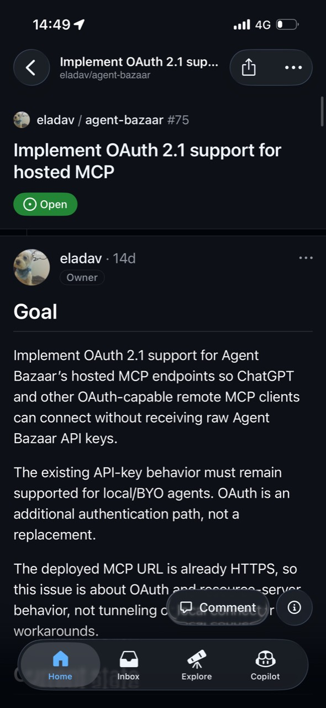
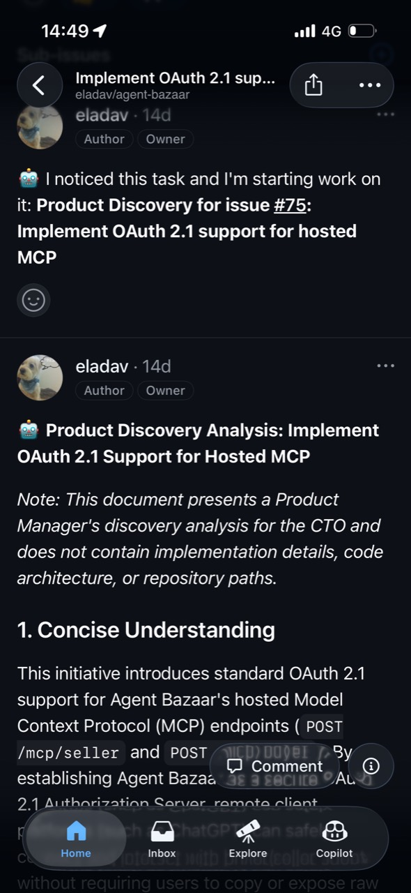
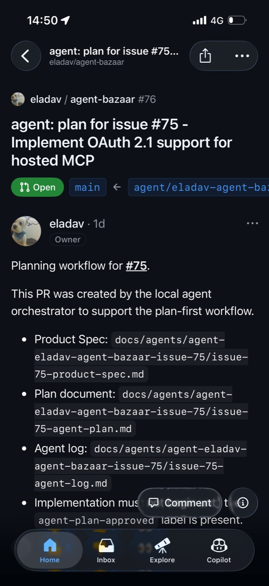
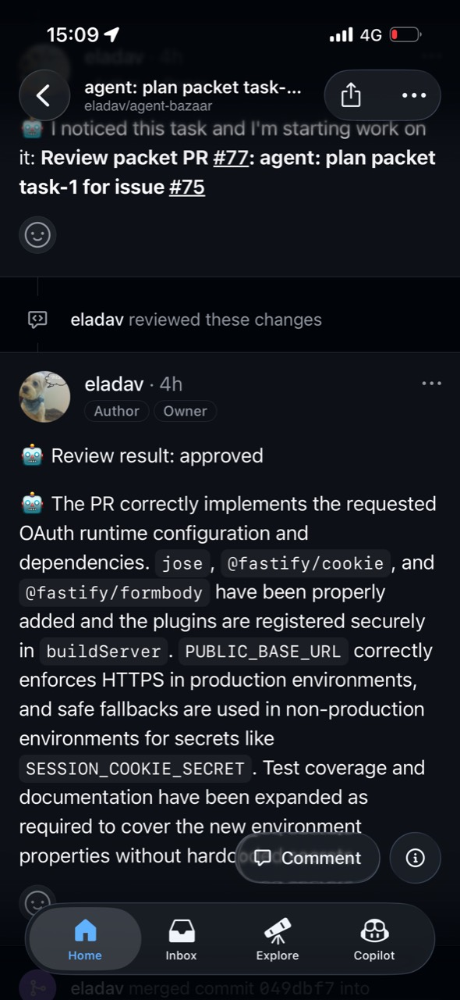

# Backburner

Backburner turns GitHub issues into reviewable pull requests using coding agents running on your own machine.

Open an issue from your phone, get back to your day, and manage the work through GitHub comments, labels, and PR reviews. Your computer does the planning, coding, testing, committing, and pushing through the agent CLIs and credentials you already use. GitHub is the control plane; your computer is the worker.

## From phone to pull request

Follow work from the GitHub mobile app while Backburner runs the agent workflow on your machine:

<table>
  <tr>
    <td align="center" width="50%">
      <strong>1. Open an issue from your phone</strong>
       
      
    </td>
    <td align="center" width="50%">
      <strong>2. Review the product direction</strong>
       
      
    </td>
  </tr>
  <tr>
    <td align="center" width="50%">
      <strong>3. Approve the implementation plan</strong>
       
      
    </td>
    <td align="center" width="50%">
      <strong>4. Review the completed work</strong>
       
      
    </td>
  </tr>
</table>

## How it works

1. You open an issue in a repository managed by Backburner.
2. A product agent can clarify the problem and propose a product direction in the issue.
3. Once product direction is approved, Backburner creates an isolated git worktree and a planning PR with a Product Spec and implementation plan.
4. You approve the plan with a GitHub label. Local agents implement it, run the repository's checks, commit, and push.
5. You review comments, request changes, and merge from GitHub—including from your phone.

Backburner never silently merges the final PR. You remain in control of approvals and the merge.

## Quick start

You need Node.js 20 or newer, `git`, an authenticated [GitHub CLI](https://cli.github.com/), and at least one supported agent CLI on your `PATH`: `agy`, `codex`, `gemini`, `claude`, or `opencode`.

Install Backburner from npm:

~~~sh
npm install --global @backburner/cli
gh auth status
backburner init
~~~

Onboarding walks you through:

- checking Node.js, `git`, GitHub authentication, and local write access;
- choosing the directories Backburner will use;
- creating a private `backburner-demo` repository or selecting existing repositories;
- detecting your installed agent CLIs and configuring models and roles;
- writing readable local configuration; and
- creating the configured Backburner labels in each selected repository.

When onboarding finishes:

1. Open the first configured repository—usually `backburner-demo` if you created it.
2. Follow the printed prefilled issue link or scan the QR code, then submit the issue.
3. Back on your Mac, start Backburner and leave it running:

~~~sh
backburner run
~~~

That is the handoff. Keep the Mac awake and online, and continue from GitHub on your phone while local agents do the work. The interactive terminal UI runs an initial cycle automatically and keeps polling; you do not need to press `r`.

For an unattended terminal without the interactive UI:

~~~sh
backburner run-loop --headless --interval-minutes 5
~~~

The prefilled first issue includes the configured product-approval label, so it enters the Product Spec and planning path immediately. An ordinary unlabeled issue starts with Product Discovery instead.

## Before onboarding a real repository

Backburner intentionally gives coding agents meaningful access to selected repositories. Before you run it:

- select only repositories whose code and issue content you trust;
- keep `allowedUsers` limited to GitHub users you trust to trigger agent work;
- understand the permission mode used by each provider CLI;
- expect prompts, repository content, and tool results to be sent to the configured model provider;
- treat `~/.backburner/outputs` as sensitive because state, journal entries, and logs can contain repository and provider output; and
- start with the private demo repository if you want to observe the workflow before granting access to production code.

Local execution means the worker and credentials stay on your machine; it does not mean the workflow is offline or that model providers never receive code. See [SECURITY.md](SECURITY.md) for the threat model, trust boundaries, and vulnerability-reporting process.

## What onboarding writes

By default, Backburner stores its data under `~/.backburner`:

- code root: `~/.backburner/code`
- management directory: `~/.backburner/management`
- outputs directory: `~/.backburner/outputs`
- state directory: `~/.backburner/outputs/state`
- journal directory: `~/.backburner/outputs/journal`
- log directory: `~/.backburner/outputs/logs`
- onboarding workspaces directory: `<code-root>/_worktrees`

Set `BACKBURNER_ROOT` to change the root used for the default code, management, and outputs directories.

Backburner writes two human-readable configuration files in the management directory:

- `repos.json`: repositories, allowed GitHub users, and workflow labels
- `agents.json`: enabled provider CLIs, models, roles, and capabilities

If either file already exists, interactive onboarding asks before overwriting it. Repository label creation is best-effort; if GitHub rejects a write, onboarding prints the labels page and exact names to create manually.

Non-interactive onboarding is available:

~~~sh
backburner init --yes
~~~

`--yes` accepts broad defaults: it selects discovered repositories, enables discovered providers, creates default agent configurations, and creates or updates labels. It does not create a private demo repository. Review the generated configuration before running Backburner.

Useful `init` flags:

~~~text
--code-root <path>       Root where managed repos are cloned
--management-dir <path>  Directory for configuration files
--outputs-dir <path>     Directory for generated state, journal, and logs
--log-dir <path>         Directory for execution logs
--workspaces-dir <path>  Directory used by onboarding readiness checks
--yes, -y                Accept defaults without prompts
~~~

## GitHub control plane

Backburner uses configurable labels to turn GitHub into a small, phone-friendly workflow:

- `agentProductApproved` approves product direction and allows the worktree/PR flow to begin.
- `agentPlanApproved` approves the implementation plan and allows implementation to run.
- `agentReview` requests an explicit code review after the PR head SHA changes.
- `agentSyncParentBranch` authorizes syncing a blocked parent branch from the default branch.
- `agentInProgress`, `planBreakdownNeeded`, and `prepareForMerge` communicate other workflow states.

The default label names are:

- `backburner:product-approved`
- `backburner:plan-approved`
- `backburner:review`
- `backburner:sync-parent-branch`
- `backburner:in-progress`
- `backburner:plan-breakdown-needed`
- `backburner:prepare-for-merge`

Custom names are supported in `repos.json` and are used in generated plans and PR instructions.

When a packet-wave assessment is published with a `blocked` decision, an allowed user can ask the strong planning agent to assess the same checkpoint again by posting this exact top-level comment on the parent integration PR:

~~~text
wave-reassess
reason: <non-empty reason>
~~~

The command must contain exactly those two non-empty lines. Extra text or malformed syntax is treated as an ordinary PR discussion comment. Reassessment does not override the prior decision: it preserves the earlier report, runs a fresh `wave_plan_assessment` attempt against the unchanged checkpoint, and only a newly published `continue` result opens the existing wave gate.

Minimal `repos.json`:

~~~json
{
  "allowedUsers": [
    "your-github-user"
  ],
  "repos": [
    {
      "id": "your-github-user-example-repo",
      "owner": "your-github-user",
      "name": "example-repo",
      "defaultBranch": "main",
      "localPath": "your-github-user/example-repo",
      "enabled": true,
      "labels": {
        "agentInProgress": "backburner:in-progress",
        "agentProductApproved": "backburner:product-approved",
        "agentPlanApproved": "backburner:plan-approved",
        "agentReview": "backburner:review",
        "planBreakdownNeeded": "backburner:plan-breakdown-needed",
        "agentSyncParentBranch": "backburner:sync-parent-branch",
        "prepareForMerge": "backburner:prepare-for-merge"
      }
    }
  ]
}
~~~

`allowedUsers` limits which GitHub users can feed issues, comments, reviews, and pull requests into task derivation. It is a trust allowlist, not a sandbox. `localPath` must be relative to `--code-root`.

## Agent configuration

Minimal `agents.json`:

~~~json
{
  "agents": [
    {
      "id": "codex-strong",
      "provider": "codex",
      "modelClass": "strong",
      "model": "sol",
      "timeoutMs": 1200000,
      "roles": [
        "product",
        "planning",
        "review",
        "discussion",
        "implementation_manager"
      ],
      "command": "codex",
      "enabled": true
    },
    {
      "id": "codex-cheap",
      "provider": "codex",
      "modelClass": "cheap",
      "model": "luna",
      "timeoutMs": 1200000,
      "roles": [
        "implementation",
        "discussion"
      ],
      "command": "codex",
      "enabled": true
    }
  ]
}
~~~

Agent selection filters enabled agents by role and `modelClass`, then breaks ties by the lowest agent ID. Model names are passed through to the provider CLI and are not validated against vendor catalogs.
`timeoutMs` sets the execution timeout for that agent. It is optional for existing configurations; provider defaults apply when it is omitted.

## Commands

Start the persistent interactive terminal UI:

~~~sh
backburner run
~~~

Run exactly one orchestration cycle:

~~~sh
backburner run --once
~~~

Run continuously without the interactive UI:

~~~sh
backburner run-loop --headless --interval-minutes 5
~~~

`run-loop` also accepts `--interval-seconds <seconds>`. Its default interval is five minutes. `SIGINT` and `SIGTERM` request a graceful stop after the current cycle.

Common path flags:

~~~text
--code-root <path>
--management-dir <path>
--outputs-dir <path>
--log-dir <path>
--broker-port <port>
~~~

Read the persisted journal:

~~~sh
backburner journal --last 20
backburner journal --repo your-github-user-example-repo --json
~~~

Start the standalone local GitHub broker MCP endpoint:

~~~sh
backburner broker --port 4444
~~~

The normal orchestrator starts its own broker on loopback. The standalone broker supports `--host` and `--port` and serves `POST /mcp` and `GET /health`. Do not expose it to an untrusted network.

## What a run does

Each cycle loads configuration and state, fetches and synchronizes enabled repositories, scans GitHub through `gh`, derives eligible tasks, starts a local GitHub broker for provider access, dispatches work to provider CLIs, and writes state, journal events, and execution logs. If a managed checkout has local changes, Backburner does not modify it; after a successful fetch, packet worktrees may still be created from the exact remote integration-branch ref.

Backburner uses isolated git worktrees as implementation units. Generated control-plane state is readable JSON under `<outputs-dir>/state`; execution logs and artifacts are under `<outputs-dir>/logs`; journal events are under `<outputs-dir>/journal`.

## Install from source

~~~sh
git clone https://github.com/eladav/backburner.git
cd backburner
npm install
npm run build
npm link
backburner init
~~~

Windows PowerShell:

~~~powershell
npm install
npm run build
npm link
backburner init
~~~

## Platform support

Backburner is intended for macOS, Linux, and Windows with Node.js 20 or newer. It is currently used on macOS. Automated CI runs the build, typecheck, tests, package dry-run, and local-install smoke checks on Ubuntu and Windows with Node.js 20 and 22.

## Development and verification

~~~sh
npm install
npm run build
npm run typecheck
npm test
npm pack --dry-run
~~~

The npm package includes the compiled CLI under `dist/src`, `README.md`, `SECURITY.md`, `LICENSE`, and package metadata.

## Security

Please read [SECURITY.md](SECURITY.md) before granting Backburner access to important repositories. Report suspected vulnerabilities privately using the process described there.

## License

[MIT](LICENSE)
